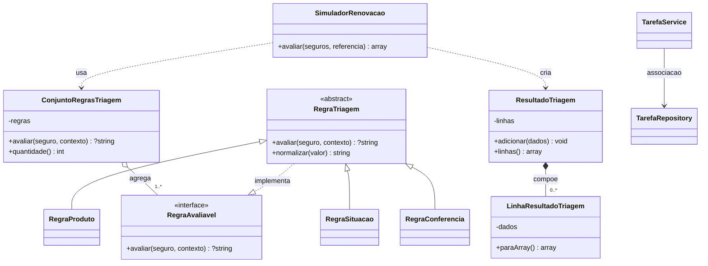

# MonitorRenova: interface, associacao, agregacao e composicao (Programacao II)

Este complemento demonstra os relacionamentos **no fluxo real de triagem** e na
estrutura de tarefas ja existente. Nao cria telas, nao consulta servicos externos
e nao muda a ordem dos motivos de classificacao. O CRUD MySQL continua no modulo
de tarefas; este novo codigo de POO funciona totalmente em memoria.

## Interface PHP: RegraAvaliavel

Arquivo: `src/triagem/RegraAvaliavel.php`

```php
interface RegraAvaliavel {
    public function avaliar(array $seguro, array $contexto): ?string;
}
```

`RegraTriagem implements RegraAvaliavel` e continua sendo uma **classe abstrata**.
As subclasses `RegraProduto`, `RegraSituacao` e `RegraConferencia` herdam
essa implementacao de contrato e sobrescrevem `avaliar()`.
O contrato torna a avaliacao polimorfica sem depender de uma classe concreta.
A funcao `normalizar()` permanece compartilhada na classe abstrata.

## Associacao: TarefaService → TarefaRepository

`TarefaService` recebe um `TarefaRepository` pelo construtor e chama seus
metodos de persistencia. Os dois objetos possuem responsabilidades diferentes:
o Service valida regras, o Repository executa PDO/MySQL. O Repository pode ser
criado sem o Service; nao se trata de heranca. A relacao aparece em
`src/TarefaService.php`. Em nivel relacional, `tarefa_acompanhamento` possui
associacao **opcional** com `seguro_mensal` via FK e LEFT JOIN no Repository;
uma FK nao deve ser confundida com composicao OO.

## Agregacao: ConjuntoRegrasTriagem ◇— RegraAvaliavel

Arquivo: `src/triagem/ConjuntoRegrasTriagem.php`.

O conjunto recebe do chamador objetos de regras **ja construidos**, aceita apenas
instancias que implementam o contrato e conserva sua identidade. As regras
continuam validas depois que o conjunto deixa de existir. Isso e agregacao
compartilhada: o todo organiza a ordem, nao controla o ciclo de vida das partes.

O `SimuladorRenovacao::avaliar()` usa esse conjunto na triagem de cada registro;
a primeira regra que retorna um motivo nao nulo prevalece. O codigo anterior
criava e percorria diretamente um array das mesmas tres regras. Agora existe
um objeto com responsabilidade especifica e possibilidade de testar sua ordem.

## Composicao: ResultadoTriagem ◆— LinhaResultadoTriagem

Arquivos: `src/triagem/ResultadoTriagem.php` e
`src/triagem/LinhaResultadoTriagem.php`.

O resultado de uma execucao **cria internamente** as linhas por
`adicionar(array $dados)`, mantem esses objetos privados e devolve copias
como arrays por `linhas()`. A linha pertence logicamente ao resultado dessa
execucao; o usuario nao fornece objetos de linha ja existentes, nem guarda
referencias mutaveis a eles. Essa responsabilidade representa composicao
(forte relacao todo-parte e ciclo de vida controlado pelo todo).

A serializacao de cada linha preserva os mesmos campos e ordem do retorno
anterior do simulador; nenhuma tela ou API precisa mudar.

## UML resumido



Observacao de modelagem: ConjuntoRegrasTriagem e ResultadoTriagem sao objetos
**locais** criados pelo metodo estatico do simulador. A seta do simulador
representa dependencia de uso/criacao, nao posse persistente de atributo.
O UML de classes definitivo do projeto deve integrar essas relacoes, sem
substituir os demais diagramas de Engenharia de Software I.

## Testes (PHP CLI, sem MySQL)

```bash
docker compose --env-file aplicacao/.env -f aplicacao/compose.demo.yaml exec web php /var/www/src/testar-relacionamentos-poo.php
docker compose --env-file aplicacao/.env -f aplicacao/compose.demo.yaml exec web php /var/www/src/testar-heranca-polimorfismo.php
docker compose --env-file aplicacao/.env -f aplicacao/compose.demo.yaml exec web php /var/www/src/testar-simulador-validacao.php
```

Os testes validam interface, identidade independente das partes agregadas,
criação interna das partes compostas, associacao tipada no construtor,
prioridade das regras e regressao dos resultados. A implementacao nao
altera seguros, MySQL, pagina inicial nem envia mensagens reais.

## Como explicar ao professor (resumo)

- Interface: contrato obrigatorio `avaliar()` para regras de diferentes tipos.
- Abstracao/heranca/polimorfismo: `RegraTriagem` e tres subclasses.
- Associacao: Service usa Repository, com ciclos de vida independentes.
- Agregacao: conjunto recebe regras que existem independentemente dele.
- Composicao: resultado cria, controla e encapsula suas linhas.
- PDO/CRUD: modulo de tarefas existente, separado da simulacao em memoria.
- Trait: opcional conforme roteiro; nao foi criada uma trait artificial.
